# Find Your Pace：拉片分析与 AIGC 制作研究

本文件与配套 HTML 同步，供人阅读和后续作为 AI 上下文使用。分析对象是 FilmLaab 为 On 自主创作的样片（Spec Ad），不应表述为已核实的昂跑官方委托广告。

## 给后续 AI 的阅读约定

- **画面观察**：来自用户指定的 YouTube 版本、平台每约 2 秒的预览帧和部分暂停画面。图片路径为相对路径；仅输入 Markdown 不等于 AI 已看到这些图片。
- **叙事依据**：来自英文自动字幕和制作方说明。字幕可能误识别，正文中文是概述，不是逐字台本。
- **分析判断**：关于节奏、人物、颜色、社会共鸣与品牌意义的解释，不是创作者原话或受众调查结果。
- **制作建议**：AIGC 工作流、镜头时长、提示词、配乐方向、原创改写，均属于新片方案，不是原片实测。
- **待核验**：未直接试听音轨；原曲、流派、乐器、BPM、调性、混音、逐帧切点、完整镜头数、平均镜长、镜头焦距与快门参数均不能据此确认。
- **时间码**：指向参考帧附近和分析段落窗，不能用于生成精确 EDL。片尾没有经核实的赛事冲线镜头，不要把“准备继续比赛”改写为“已经完赛”。
- **后续输出**：继承上述证据边界；提出新方案时标明“建议”；如果补充原片实测，请记录验证方法与版本。

## 核心结论

影片把运动中的向前，落到一个人在失去父亲之后愿意重新行动的过程。值得迁移的机制是：具体关系、生活阻力、小动作转折、空间释放、后段关系揭示；无需复制人物悲剧，才能复用这个结构。

## 文件与来源

- [HTML 图文交互版本](Find-Your-Pace-拉片与AIGC制作研究.html)
- [结构化重点镜头数据](shot-notes.json)
- [原片](https://www.youtube.com/watch?v=fFnXvKFcrIY)
- [制作方说明](https://www.filmlaab.com/works/on)

**先说明范围：**这是一份有画面证据的视觉与叙事拉片，附 AIGC 制作方案。声音未能直接试听，精确切点未逐帧测量；音乐流派与配器部分以“建议方案”呈现，不冒充原片实测。截图来自用户链接的 YouTube 预览帧，全部已内嵌。参见文末“这份拉片的依据与边界”。

## 她寻找的配速，是失去之后如何继续生活。

最值得学的，是把运动品牌的“向前”变成一个具体的人重新行动的过程。外部任务是准备一场跑步比赛；内部任务是重新安排自己与父亲、记忆和缺席的关系。跑步为这段关系提供动作，电话为这段动作提供情感。

### 叙事发动机

一通得不到即时回应的留言。观众先进入亲密关系，直到后段才知道这段关系的特殊处境。

### 人物的矛盾

她想履行共同的约定，又承受训练与情绪的重量。行动困难有原因，动起来才有价值。

### 品牌的落点

鞋、运动服、准备动作、道路逐渐进入故事。品牌更像与人同行的装备和立场。

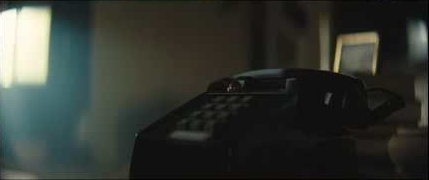

[回放相邻时间窗：00:08–00:16](https://www.youtube.com/watch?v=fFnXvKFcrIY&t=8s)

电话：人物不在场，关系已经在场。

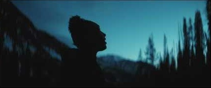

[回放相邻时间窗：02:00–02:08](https://www.youtube.com/watch?v=fFnXvKFcrIY&t=120s)

结尾回到深蓝：哀伤没有消失，行动已经改变。

**别把概念当成已发生的镜头。**自动字幕中，结尾仍在说翌日比赛与终点的约定。画面索引也没有提供她冲过赛事终点的证据。因此本报告不把“夺冠”“完成比赛”“彻底走出悲伤”写成影片事实。

背景核验：制作方明确称其为自主创作的 Spec Piece，并说明选择了叙事路线。[FilmLaab 项目页 ↗](https://www.filmlaab.com/works/on)。本文对情感、品牌及社会意义的评价属于分析判断。

## 先收紧，再打开，最后把呼吸还给人物。

节奏有四个同时工作的维度：**切换多快、身体动多快、画面给多少空间、信息何时被揭示。**一个快速剪辑的低能量人物段，仍然可能让人感到沉重；一个很长的奔跑镜头，也可能让人感到释放。不要把“呼吸感”缩减成慢镜头。

情绪动能示意为人工解读，不是逐帧切点、音量或 BPM 测量。

### 五段结构（分析分段，非精确切点）

- 00:00–00:14；等待／进入关系；电话、空房间、父亲的留言提示。先建立听的理由。。[回放](https://www.youtube.com/watch?v=fFnXvKFcrIY&t=0s)
- 00:14–00:48；下沉／生活阻力；床、眼睛、水、窗与困难的身体。信息和能量都被压住。。[回放](https://www.youtube.com/watch?v=fFnXvKFcrIY&t=14s)
- 00:48–01:20；聚拢／重新选择；纪念物、训练、鞋、门和表。决心被拆成可见动作。。[回放](https://www.youtube.com/watch?v=fFnXvKFcrIY&t=48s)
- 01:20–01:46；展开／真正流动；树林掠过、山路、跑者、贴地鞋部。空间和动能释放。。[回放](https://www.youtube.com/watch?v=fFnXvKFcrIY&t=80s)
- 01:46–02:13；收回／重新理解；暮色与亲密近景承接失去父亲的信息，最后由品牌署名。。[回放](https://www.youtube.com/watch?v=fFnXvKFcrIY&t=106s)

以上是便于分析的段落窗，允许相邻动作跨界，不宣称是准确剪切点。点段落可打开带起止时间的原片回放。

### 呼吸点 ① 留给物件

电话不是人像之间的填空。它先建立安静和等待，观众才会对随后的声音敏感。

### 呼吸点 ② 留给动作的前一拍

起身、系鞋、出门前的停顿让“决定”可见。只保留动作高潮，人物会像一直被剪辑催着走。

### 呼吸点 ③ 留给到达后的余温

跑步释放之后重新贴近人物。若结尾直接堆冲刺、航拍、Logo，丧失关系这条线就会被速度盖住。

**AIGC 剪辑建议（新片方案，不是原片数据）：**先做约 120 秒的有声粗剪；开场留 2–4 秒空间，行动准备单镜约 1.5–3 秒，奔跑组可用 0.5–1.5 秒局部加少量 3–5 秒母镜头，末段恢复 3–5 秒。节奏优先服从表演与语句，别强行每拍切镜。

## 结尾改变的，是我们对开头的理解。

*外部目标*

### 为约定中的比赛做准备

这是可以被拍摄的任务：穿鞋、练习、出门、在路上移动。

*内部障碍*

### 身体在场，内心仍停在原处

低能量生活与重复训练，让“跑不起来”先成为感受。

*后段揭示*

### 这通电话不能再等到回电

结尾关于父亲已离世的信息，回头改变了电话、照片与共同约定的含义。

### 为什么这个结构有效

它先让观众产生“她为什么如此沉重”的问题，再交出答案。照片和电话提供可回想的线索，减少结尾像突然塞进悲剧的感觉。观众第一次看是跟随情绪；第二次看，物件都带着新的信息。这种回看价值比单次视觉惊奇更耐用。

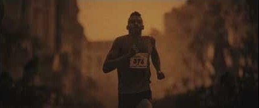

[回放相邻时间窗：00:48–00:56](https://www.youtube.com/watch?v=fFnXvKFcrIY&t=48s)

照片先作为关系线索，结尾再赋予其更具体的情感。

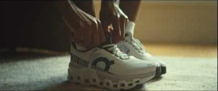

[回放相邻时间窗：01:02–01:10](https://www.youtube.com/watch?v=fFnXvKFcrIY&t=62s)

转折落在鞋与手的具体行动里，而不只存在于旁白里。

### 人物弧光应当写小一点

更准确的变化是：从难以面对约定，走向愿意带着思念继续准备。不是从“脆弱”升级为“无敌”。如果你用 AIGC 创作，要先决定人物最后能做到的最小动作：按下手表、跨出门、开始第一步。一个可信的小动作，可以承载比大场面更大的转折。

**值得挑战的地方：**父亲离世的后置揭示很有冲击，也可能让一部分观众觉得被情绪反转操控；旁白承担的信息较多，静音观看时不易理解关系。仿作时应补一个能独立成立的视觉线索，而不是一味加重悲惨经历。

## 先设计一个有生活的人，再让她穿运动服。

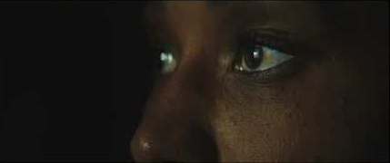

[回放相邻时间窗：00:24–00:32](https://www.youtube.com/watch?v=fFnXvKFcrIY&t=24s)

细节不是噪点滤镜：雀斑、眼下与肤色变化属于同一张脸。

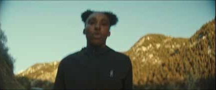

[回放相邻时间窗：01:32–01:40](https://www.youtube.com/watch?v=fFnXvKFcrIY&t=92s)

双侧发团形成稳定剪影，远景与逆光也能认出人物。

### 可辨识的外形

深肤色、自然卷发的双侧发团、可辨识的眉眼与雀斑。黑或深蓝运动服保持轮廓简洁，白鞋成为动作中的明度锚点。这里描述可见外观，不推断人物族裔或真实经历。

### 可辨识的身体

从躺卧、撑起、俯身到奔跑，人物有重量和费力的过程。真实感来自动作前后的身体连续，而不只是皮肤清晰度。

### 可辨识的关系

留言中的亲密称呼、室内物件、旧照片、共同比赛的约定，让她拥有画面之外的生活。观众记住的是关系中的人。

### 真实感的五个层次

- **身份：**脸型、鼻梁、眉形、发际线和发团尺寸不随镜头改变。
- **材质：**肤色有层次，汗水有位置，布料有折痕；不要把“真实”写成满脸随机毛孔。
- **身体：**抬手先有肩部参与，落脚带动骨盆和上身；运动不是只有腿在摆。
- **状态：**前后镜头的汗量、发丝松散度、疲劳和服装湿度要连续。
- **目的：**每次低头、停顿、看表都知道为了什么。无目的的微表情会显得像生成演示。

### 可直接执行的人物设定卡（新片参考）

**固定项：**成年女性跑者；选定一套独立原创面孔；自然卷发双侧发团或你自己的独特轮廓；稳定雀斑布局；深色拉链上衣；同一双浅色跑鞋。先做正面、侧面、背面、半身、全身与无表情近景。

**可变化项：**服装分为“居家／训练／户外”三套状态；体态从收拢到打开；光从压缩到开放；情绪只改变视线、动作启动速度与呼吸幅度。

**不要要求：**“和演员一模一样”“完美女性”“时刻强大自信”“高级电影感”。这些词要么无助于控制，要么抹掉人物自身的矛盾。

建议先验证四个镜头能否认出同一个人：床上侧脸、眼部极近景、逆光背影、跑步正面。四镜都成立，再扩充整片。人物设计的成败，在不同景别之间最容易暴露。

## 低调照明、灰绿阴影、琥珀光，再落回暮蓝。

风格判断：带主观情绪的写实叙事运动短片。画面有低调照明、较深黑位、受控饱和度、柔化高光与可见空气感；局部耀斑和拖影增加记忆感。可以说它有胶片化的观感，但不能据此断言使用胶片、某支镜头或某款 LUT。

[回放相邻时间窗：00:02–00:10](https://www.youtube.com/watch?v=fFnXvKFcrIY&t=2s)

A / 室内：灰绿与局部乳白窗光。

[回放相邻时间窗：01:04–01:12](https://www.youtube.com/watch?v=fFnXvKFcrIY&t=64s)

B / 准备：肤色、木色与暖光获得空间。

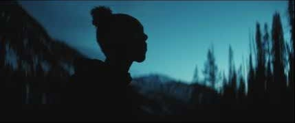

[回放相邻时间窗：01:58–02:06](https://www.youtube.com/watch?v=fFnXvKFcrIY&t=118s)

C / 暮色：深蓝环境保留哀伤。

上方色板由对应 YouTube 预览帧做像素聚类生成；仅代表该压缩图的主要颜色，不是原始摄影文件、LUT 或官方品牌色。

### 颜色为什么平衡

### 大色块先统一

衣服、树木、室内暗部落在低饱和深色范围，背景不会和脸、窗光、白鞋同时争抢。色彩统一从服装与布景开始。

### 冷暖不是全画面套色

室内的冷灰环境里有暖亮区域；外景蓝天和阴影里仍有自然肤色与亮部。局部温差让光可信，肤色保有主体性。

### 明度比颜色更关键

白鞋、窗、天空成为注意力锚点。暗部大面积承托亮部，脸不必全面提亮。画面有分量，也因此依赖较好的显示环境。

### 构图的情绪方向

**前段：**用门框、床、窗边和近距离面孔压缩人物的活动空间。**中段：**手、鞋、门、表把行动拆成小的因果。**跑步段：**道路引导线、山谷纵深、低机位和环境位移让方向感打开。**结尾：**以暗色剪影保留空间，不用更宏大的景别继续加码。

[回放相邻时间窗：00:30–00:38](https://www.youtube.com/watch?v=fFnXvKFcrIY&t=30s)

室内构图：光在外面，人物被房间框住。

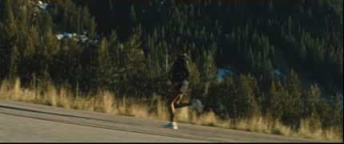

[回放相邻时间窗：01:22–01:30](https://www.youtube.com/watch?v=fFnXvKFcrIY&t=82s)

山路构图：身体终于拥有可进入的纵深。

**复现顺序：**先锁服装、场景和光向 → 匹配每镜的明度和肤色 → 再压饱和度与统一阴影倾向 → 最后才加颗粒、柔光、耀斑。不要先套一层青橙，再尝试修复错误的光线。

### 暗调的代价也要学

深肤色、深衣和深背景容易融在一起。某些低照度预览已经很难读清人物。自己的片子要在手机低亮度上检查：眼睛是否可见、下颌是否与背景分离、运动轮廓是否可读。黑位有层次，才是暗调；信息丢失不是风格。

## 声音负责关系，动作负责证明。

**声音核验边界：**本次已读取英文自动字幕及制作方关于 VO、歌曲、声音设计的说明，但未能导出或直接试听音轨。因此不能确认原曲、音乐流派、乐器、BPM、调性、混音数值，也不能把下面的制作建议写成原片实测。字幕可能有识别错误。需要核验的部分均保留原片定时回放。

### 已能成立的视听结构

### 声音让缺席者在场

自动字幕在约 00:10 出现留言提示，随后进入女儿对父亲的倾诉。画面提供电话与个人生活，让说话有对象、有媒介，而不是全知解说。

### 图像补充话语的触感

关于训练困难与失落的语言，被床、书写、水、俯身和重复练习转为身体经验。无需每句话都配字面插图。

### 声音在后段改写画面

约 01:50–02:08 的自动字幕逐步说明她想再听父亲声音、父亲已离世、将继续比赛。早先物件因此获得新的解释。

制作方确认声音设计是该项目的重要部分，但未公开给出曲名与谱速。[项目说明 ↗](https://www.filmlaab.com/works/on)。此处中文为结构概述，不是完整字幕翻译。

### 如果你要做同类情绪曲线，给作曲／AIGC 音乐的方案

以下均为新片制作建议 方向可用 **Ambient Cinematic → Organic Pulse → 克制的 Post-rock / Hybrid Score → 稀疏尾奏**。这是功能性配乐 brief，不是对原片曲风的认定。优先寻找可分轨、可剪段落、有足够留白的音乐，避免歌词持续抢占留言的语义空间。

| 段落功能 | 配乐与声音建议 | 画面如何配合 |
| --- | --- | --- |
| 建立私密关系 | 稀疏低密度织体；电话声可做窄频与轻底噪；女声保持近、自然。 | 物件与静止身体先建立位置；不要每个物件都配夸张拟音。 |
| 承受与蓄力 | 缓慢加入重复脉冲；让水、布料、呼吸的触感有局部存在。 | 用动作启动前的停顿制造张力；强拍不必全部切镜。 |
| 选择与出发 | 在决心后的动作落点增加低频或打击层，密度逐步增加。 | 门、鞋、腕表成为同步点；可尝试声音先到、画面后切的 J-cut。 |
| 空间释放 | 扩展声场与和声，保留脚步接触感；并非只提高总音量。 | 用远景承接延长的乐句，用局部镜头形成短促重音。 |
| 关系揭示 | 适当减层、给女声让位；末句后让环境声或尾音继续。 | 少切一次，留一口气，让观众完成理解再看到品牌。 |

### 怎样验证“卡点”，而不是凭印象说

取得音轨后，先分别标记音乐强拍、和声变化、音色进入点、旁白停顿，再对照实际切点。强拍与镜头切换重合只是其中一种同步；动作落地、人物抬眼、门打开也可能承担重音。歌曲 BPM、剪切频率、跑步步频应分别记录，不能互相替代。

**配乐提示词／原创方案**

Intimate cinematic underscore for a personal running story. Sparse atmospheric opening, restrained organic pulse, gradual expansion into warm harmonic layers and tactile percussion, then a quiet unresolved ending. Leave space for a close female spoken message. Emotional restraint, human vulnerability, forward motion. No constant trailer hits, no continuous lead vocal. Deliver alternate stems and an ending with room for silence.

## “找自己的配速”能共鸣，但必须被生活证明。

我的判断：这个主题有跨出跑步圈的潜力，因为“跟不上”不只发生在运动里，也发生在工作、成长、失去亲人和人生进度的比较中。影片把一句可泛用的口号，绑定到一段具体关系，因此更有机会被记住。这是传播潜力的判断，不是已有的受众研究结论。

### 运动层

不是每个人都在追求更快。重新开始训练、允许状态波动，也是一种运动经验。影片的准备动作可为非精英跑者提供入口。

### 生活层

人在失去之后，生活仍不断要求继续。一个明确的小任务，让庞大的情绪暂时有了可以承受的尺度。

### 关系层

保留语音、物件或共同习惯，是容易被理解的关系经验。它使“陪伴”比“战胜自己”更具体。

### 也要看到它可能失效的地方

- **容易变成万能鸡汤：**如果换成任何品牌都成立，口号就没有自己的位置。需要鞋、运动习惯、训练身体的真实细节来建立关联。
- **容易把悲伤当作燃料：**仿作若只追求“最后发现父亲去世了”的反转，情绪会比人物先被看见。应该先让关系可信。
- **容易承诺过度：**运动可以成为人物应对生活的方式，影片不能因此被解读成“跑步解决所有心理困扰”。
- **可及性有限：**漂亮山路、专业装备、充足训练时间对部分观众有距离。若面向普通城市青年，可用楼道、河边、社区跑道与晚归时段替代。

### 中文语境里，值得迁移的是机制

“你的节奏，不必赶上所有人”有普适性，但仅有文案不够。可以选择一个小而具体的冲突：下班后总是无法按计划跑完的人、重新适应身体的人、离开熟悉城市的人。先写出她今天为什么难以出门，再决定最后迈出哪一步。无需复制父亲离世，才能复制影片的情感机制。

**一个原创改写方向：**一位习惯用成绩衡量自己的城市跑者，反复在手机里删掉“今天又没完成”的语音。她最终没有冲刺破纪录，只把表从成绩页面切回时间，慢慢跑过熟悉的桥。主题落在“重新拥有自己的速度”。这是原创开发示例，非原片情节。

## 30 个重点镜头节点。每一张，都要有任务。

这是基于原片每 2 秒预览帧与重点暂停画面的**镜头节点拆解**，不是逐帧 EDL，也不是完整镜头数量统计。时间标记指向该画面附近；短于 2 秒的镜头可能未被采样，精确入出点仍需原片回放。每张图都附“为什么这样拍”和“AIGC 怎样实现”。

当前显示 30 / 30 个重点节点

[回放相邻时间窗：00:00–00:08](https://www.youtube.com/watch?v=fFnXvKFcrIY&t=0s)

00:02 / 室内／远景

空间

### 01 · 空间先于人物

**看见：**电话在前景，床与窗在纵深处。光进入了房间，人物尚未行动。

**学什么：**把观众的注意力先交给一个“等待回应”的物件；前后景关系让空房间也有情绪。

**AIGC：**同一房间先做平面与光位图；单独生成电话、窗、床三项参考。只做极慢推进，别让书本和电话漂移。

[回放相邻时间窗：00:08–00:16](https://www.youtube.com/watch?v=fFnXvKFcrIY&t=8s)

00:10 / 物件／近景

物件

### 02 · 电话成为叙事主角

**看见：**旧式电话占据画面，背景仍是柔化的室内。

**学什么：**父亲以声音和物件存在，为结尾重新解释这通电话留出空间。不是无关的氛围空镜。

**AIGC：**电话机固定模型与材质；录音灯等小变化用后期合成。不要让生成模型逐帧重画按键。

[回放相邻时间窗：00:12–00:20](https://www.youtube.com/watch?v=fFnXvKFcrIY&t=12s)

00:14 / 人物／全景

人物

### 03 · 先允许她没有力气

**看见：**她躺在床上，身体被枕头与暗部包围。

**学什么：**先呈现低能量的普通人，再呈现运动者。身体状态比一张“难过的表情”更可信。

**AIGC：**表演指令用“目光停住、手臂懒散、胸口轻微起伏”；避免整张脸持续哭泣。

[回放相邻时间窗：00:14–00:22](https://www.youtube.com/watch?v=fFnXvKFcrIY&t=14s)

00:16 / 人物／侧面近景

人物

### 04 · 让观众靠近

**看见：**侧脸被局部光照亮，大面积区域仍留在暗部。

**学什么：**从空间走向身体，收窄注意力；局部照明保留亲密感与未说出的事情。

**AIGC：**保留同一鼻梁、唇形与发际线。先做静帧近景验证身份，再做一次缓慢眨眼。

[回放相邻时间窗：00:18–00:26](https://www.youtube.com/watch?v=fFnXvKFcrIY&t=18s)

00:20 / 动作／中景

人物

### 05 · 起身不是振作宣言

**看见：**她从床上撑起身体。

**学什么：**一个很小的身体动作就能推进故事；别用励志姿态替代具体行为。

**AIGC：**拆成“手撑床面→肩膀上升→坐稳”三个可检验状态；必要时只保留中间一段。

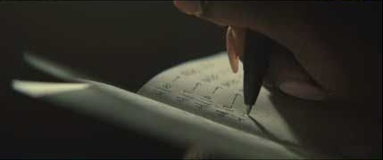

[回放相邻时间窗：00:22–00:30](https://www.youtube.com/watch?v=fFnXvKFcrIY&t=22s)

00:24 / 手部／特写

物件

### 06 · 生活细节补足人物

**看见：**笔在纸上书写。文字内容不能从当前预览清楚辨认。

**学什么：**她有内在生活，不只是跑步剪影。笔记是心事的容器，但不能擅自认定是训练计划或遗书。

**AIGC：**手写字由真实笔迹素材或后期完成；生成手部只承担动作，不承担可读长文字。

[回放相邻时间窗：00:24–00:32](https://www.youtube.com/watch?v=fFnXvKFcrIY&t=24s)

00:26 / 眼睛／极近景

人物

### 07 · 真实感落在皮肤上

**看见：**可见雀斑、皮肤纹理与不均匀的明暗。

**学什么：**记忆点来自具体面孔；不把肤质抹平，观众才相信这个人经历过生活。

**AIGC：**人物基准图锁定雀斑分布、眉眼距离、眼下纹理；统一细节密度，不要每镜随机增减。

[回放相邻时间窗：00:26–00:34](https://www.youtube.com/watch?v=fFnXvKFcrIY&t=26s)

00:28 / 身体／近景

人物

### 08 · 水是触觉，不只是好看

**看见：**水流经过脸与手，画面仍偏暗。

**学什么：**把心理重量转为可以感受到的物理接触，提供生活的连续性。

**AIGC：**水与多手指是高风险组合；优先侧脸加单手，水滴可分层合成，别一镜承担太多动作。

[回放相邻时间窗：00:30–00:38](https://www.youtube.com/watch?v=fFnXvKFcrIY&t=30s)

00:32 / 空间／全景

空间

### 09 · 窗边留下停顿

**看见：**她靠近窗，床铺与室内陈设保留在画面中。

**学什么：**把身体与外界放在同一画面：出口已经存在，行动还没有完成。

**AIGC：**窗外光不能吞掉脸部结构；固定窗框几何与光向，使用人物小幅位移。

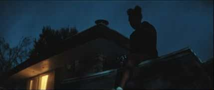

[回放相邻时间窗：00:34–00:42](https://www.youtube.com/watch?v=fFnXvKFcrIY&t=34s)

00:36 / 外景／低角度

空间

### 10 · 换场，但压力仍在

**看见：**蓝调时分的屋顶与人物，窗中保留暖色光。

**学什么：**从室内走到室外不等于情绪已经解决；冷外景和暖窗形成归属与距离的对照。

**AIGC：**先确定屋顶结构和站位；脚与屋顶接触、重心、边缘遮挡必须逐帧检查。

[回放相邻时间窗：00:40–00:48](https://www.youtube.com/watch?v=fFnXvKFcrIY&t=40s)

00:42 / 训练／近景

动作

### 11 · 把困难放进身体

**看见：**她俯身发力，脸上有疲惫与专注。

**学什么：**观众看见训练成本，后面的奔跑才有来处。运动身体不能永远轻盈、干净、无汗。

**AIGC：**选择一种明确动作；肩胛、手肘与重心要协同。用短镜头保留可信的一次发力。

[回放相邻时间窗：00:46–00:54](https://www.youtube.com/watch?v=fFnXvKFcrIY&t=46s)

00:48 / 物件／插入

物件

### 12 · 过去的成绩成为压力

**看见：**奖牌、号码布等运动纪念物出现在陈设中。

**学什么：**无声地建立运动与家庭记忆的关联；具体归属不能只凭物件确认。

**AIGC：**生成不可读物件外形，号码和徽章后期补。比起凭空加回忆人物，这类插入镜头更稳。

[回放相邻时间窗：00:48–00:56](https://www.youtube.com/watch?v=fFnXvKFcrIY&t=48s)

00:50 / 照片／特写

物件

### 13 · 照片给关系一个形状

**看见：**相框中的跑者与前后纪念物形成一组线索。

**学什么：**为“父亲与跑步”的关联提供视觉落点；观众先感受关系，后获得完整解释。

**AIGC：**照片独立制作后贴进相框；不让图生视频重新生成人脸。不要把未经确认的照片人物身份写成事实。

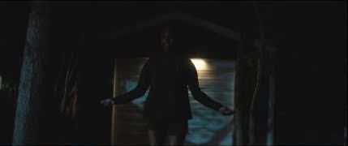

[回放相邻时间窗：00:52–01:00](https://www.youtube.com/watch?v=fFnXvKFcrIY&t=52s)

00:54 / 训练／中景

动作

### 14 · 重复运动与原地感

**看见：**她在暗处跳绳。

**学什么：**身体在移动，位置却不改变，能够承接旁白中“停滞”的感受。属于画面与意义的呼应。

**AIGC：**长绳连续运动容易穿模；可只展示上身和节拍，绳体另做，或拍摄真实运动参考。

[回放相邻时间窗：00:54–01:02](https://www.youtube.com/watch?v=fFnXvKFcrIY&t=54s)

00:56 / 人物／叠影

动作

### 15 · 分裂的主观感受

**看见：**同一个人的脸与运动方向发生叠加、拖影。

**学什么：**让心理状态进入画面形式，而不是全靠旁白解释。这里的失衡与后面清晰奔跑构成对照。

**AIGC：**先生成稳定单人素材，再复制、延迟、遮罩混合；不要直接要求模型生成两张相互融合的脸。

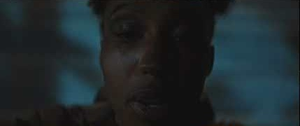

[回放相邻时间窗：00:58–01:06](https://www.youtube.com/watch?v=fFnXvKFcrIY&t=58s)

01:00 / 人物／近景

人物

### 16 · 决心从脸开始

**看见：**疲惫的脸仍在，眼神开始承担行动。

**学什么：**转折不是换一个更漂亮的人，也不是突然微笑，而是同一身体换了一种方向。

**AIGC：**锁住疲态与汗量，只调整视线和颈肩姿态。状态变化要小，身份变化要零。

[回放相邻时间窗：01:02–01:10](https://www.youtube.com/watch?v=fFnXvKFcrIY&t=62s)

01:04 / 产品／低机位特写

产品

### 17 · 鞋履获得叙事位置

**看见：**白鞋在室内地面，双手做准备。

**学什么：**鞋进入“准备出发”的因果链，比孤立的产品旋转更自然。此处建立品牌物件的功能关联。

**AIGC：**鞋型、鞋孔、鞋底结构需专门参考；鞋带动作可实拍或合成，Logo 最后贴附。

[回放相邻时间窗：01:06–01:14](https://www.youtube.com/watch?v=fFnXvKFcrIY&t=66s)

01:08 / 训练／低机位

动作

### 18 · 练习把意愿变成行动

**看见：**室内身体练习与鞋、手部准备形成动作组。

**学什么：**用重复小动作把情绪转折落地。观众需要看见付出，而不只是听见承诺。

**AIGC：**每个生成镜头只负责一次发力；保持服装与窗光一致，剪辑承担重复节奏。

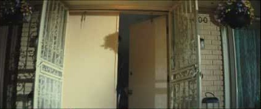

[回放相邻时间窗：01:12–01:20](https://www.youtube.com/watch?v=fFnXvKFcrIY&t=72s)

01:14 / 空间／中景

空间

### 19 · 门是结构性的切口

**看见：**人物经过门口，光线与空间关系变化。

**学什么：**从私人空间走向外界。门的开合是天然段落标点，可同时转换色调与速度。

**AIGC：**固定门轴和开门方向；手离开把手前后的接触要检查，复杂动作拆镜。

[回放相邻时间窗：01:14–01:22](https://www.youtube.com/watch?v=fFnXvKFcrIY&t=74s)

01:16 / 人物／中近景

动作

### 20 · 行动落到一个小决定

**看见：**出门后查看或操作腕表。

**学什么：**腕表把抽象决心变成可观察的开始；不必靠大口号解释她准备好了。

**AIGC：**屏幕文字与UI后期添加；腕带位置、肤色和袖口须保持。

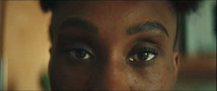

[回放相邻时间窗：01:16–01:24](https://www.youtube.com/watch?v=fFnXvKFcrIY&t=76s)

01:18 / 眼睛／特写

人物

### 21 · 重新给她一双眼睛

**看见：**与前段眼部镜头形成可对照的正面视线。

**学什么：**人物仍是同一个人，但视线的方向和光的开放程度已改变。形式重复让变化可读。

**AIGC：**直接复用前段人物参考与眼部比例；改变光比和视线，不替换五官。

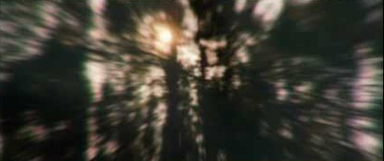

[回放相邻时间窗：01:18–01:26](https://www.youtube.com/watch?v=fFnXvKFcrIY&t=78s)

01:20 / 环境／模糊运动

动作

### 22 · 让风景先变成速度

**看见：**林木以径向或运动模糊的方式掠过。

**学什么：**在看到完整跑姿前，让观众先感受流动；这是动能过桥，不只是风景插片。

**AIGC：**环境静帧加可控的径向模糊与位移；模糊方向必须与前后镜头运动方向一致。

[回放相邻时间窗：01:22–01:30](https://www.youtube.com/watch?v=fFnXvKFcrIY&t=82s)

01:24 / 跑步／远景

空间

### 23 · 终于给身体空间

**看见：**山路、树林与人物共同构成开阔画面。

**学什么：**从压缩的室内和脸部走向有纵深的道路，空间打开本身就是情绪释放。

**AIGC：**先做跑步母镜头，锁定道路走向、山体与太阳方位；人物尺度要允许看清人与环境关系。

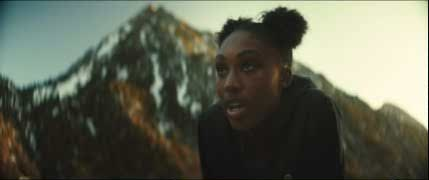

[回放相邻时间窗：01:28–01:36](https://www.youtube.com/watch?v=fFnXvKFcrIY&t=88s)

01:30 / 跑步／近景

人物

### 24 · 跑步的人仍会累

**看见：**她在山路上奔跑，面部与身体运动可见。

**学什么：**保留用力和呼吸的可能性，不把出发处理成轻松获胜。

**AIGC：**短时稳定跟拍；发团回弹、肩部起伏与落地节拍关联，避免脸像固定贴片。

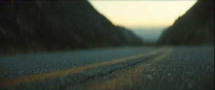

[回放相邻时间窗：01:34–01:42](https://www.youtube.com/watch?v=fFnXvKFcrIY&t=94s)

01:36 / 道路／贴地机位

空间

### 25 · 先让道路空一会儿

**看见：**低角度道路在前景延伸，人物随后进入相近构图。

**学什么：**空画面给到来的身体蓄势。不是每一秒都必须塞满人物和信息。

**AIGC：**空道路与入画分别生成后合成，保持焦点、地平线、路面纹理与运动模糊一致。

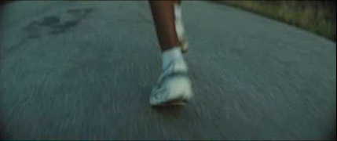

[回放相邻时间窗：01:38–01:46](https://www.youtube.com/watch?v=fFnXvKFcrIY&t=98s)

01:40 / 产品／运动特写

产品

### 26 · 把速度放在落脚处

**看见：**鞋与脚经过贴地视角。

**学什么：**低机位把抽象的“前进”变成接触、重量与摩擦，同时让产品进入动作。

**AIGC：**用真实跑步步态参考；逐帧检查脚底接触、影子、鞋形，无法通过就缩短镜头或合成实拍脚部。

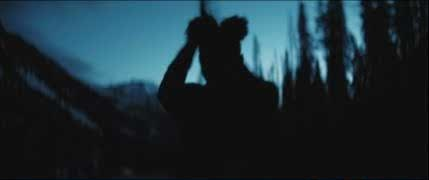

[回放相邻时间窗：01:46–01:54](https://www.youtube.com/watch?v=fFnXvKFcrIY&t=106s)

01:48 / 人物／暮色近景

人物

### 27 · 从运动回到一个人

**看见：**深蓝天色下，双手接近头部与发型。

**学什么：**速度不再是唯一关注点，观众重新回到她与自己的相处。

**AIGC：**把整理头发、抬手等动作拆开，避免多手指与发丝同时复杂变形。

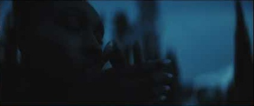

[回放相邻时间窗：01:54–02:02](https://www.youtube.com/watch?v=fFnXvKFcrIY&t=114s)

01:56 / 人物／近景

人物

### 28 · 留给告别的余地

**看见：**人物与暗色环境形成安静、贴近的关系。

**学什么：**结尾的亲密感比再加一段冲刺更能承接父亲缺席的信息。动作具体含义需回放核实。

**AIGC：**降低动作幅度，让眼神、手和肩颈表达；不要自动加嚎哭或夸张释怀。

[回放相邻时间窗：02:00–02:08](https://www.youtube.com/watch?v=fFnXvKFcrIY&t=120s)

02:02 / 人物／剪影

空间

### 29 · 深蓝里仍然出发

**看见：**相似山地环境中，她的轮廓与开阔天空并置。

**学什么：**希望与哀伤可以同时存在。颜色回冷，行动仍向前，避免“痛苦已经彻底消失”的假象。

**AIGC：**暮色参考独立锁定；让黑衣与背景保留分离，不用简单压暗整张图模拟夜景。

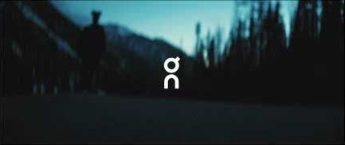

[回放相邻时间窗：02:08–02:13](https://www.youtube.com/watch?v=fFnXvKFcrIY&t=128s)

02:10 / 品牌／叠印

产品

### 30 · 品牌作为最后的署名

**看见：**On 标志出现在山路背景上，随后出现制作方署名。

**学什么：**前面的身体、道路和陪伴感为品牌建立意义；结尾标志完成归属，不必再增加产品说明。

**AIGC：**标志使用合规矢量文件后期叠印；原片中制作方署名属于样片语境，自己成片需重新设计。

## 把“电影感”拆成可控的连续性。

难点不在生成某一张漂亮山路，而在让同一个人、同一双鞋、同一种运动重量，在不同镜头里持续成立。优先把预算花在人物、步态、表演和声音，再把空间做大。

**01**

### 先写关系

人物想做什么？为什么此刻做不到？给谁说话？最后最小的改变是什么？四题先于提示词。

**02**

### 先做有声粗剪

临时旁白＋占位图＋参考音乐先跑通全长，找转折与停顿。声音时长决定需要多少画面。

**03**

### 建立四本参考册

人物、服装产品、场景光线、摄影运动。每镜引用明确版本，避免每次从一句抽象描述重来。

**04**

### 先验证高风险镜头

先做近景表演、完整跑姿、系鞋带、双手近脸。过不了，立即改镜头，不要等整片都生成完。

**05**

### 分层制作

人像与环境负责主体；字、Logo、照片、叠影、水滴、耀斑由后期控制。复杂运动可结合实拍素材。

**06**

### 最后统一质感

先剪动作、再配音拟音、再匹配颜色，最后添加统一颗粒与光学效果；逐镜检查身份和物理接触。

### 镜头难度与替代方案

| 任务 | 主要风险 | 更可控的做法 | 通过标准 |
| --- | --- | --- | --- |
| 卧床、窗边、背影 | 人物漂移、无目的表情 | 已锁定静帧＋小幅动作；用视线与体态变化 | 人物可认、光向固定、动作有目的 |
| 皮肤、眼部极近景 | 美颜、雀斑随机、虹膜漂移 | 专用身份近景参考，控制景深与眨眼幅度 | 同一张脸；纹理稳定；视线可读 |
| 跑步完整步态 | 脚滑、膝关节异常、头部锁死 | 真实运动参考；短跟拍；必要时实拍身体＋合成 | 落脚承重、身体起伏与脚步一致 |
| 系带、开门、看表 | 手指穿模、接触缺失、UI乱码 | 拆动作；插入物件镜头；字与UI后期制作 | 手与物体接触；物件结构连续 |
| 叠影与速度过桥 | 两张脸融合、空间方向混乱 | 稳定素材后期延迟叠加；环境做定向模糊 | 效果有情绪动机；前后方向可理解 |
| 产品识别 | 鞋型与标志每镜变化 | 产品独立资产；局部合成；标志使用矢量叠印 | 轮廓、鞋底、标志位置一致 |

### 建议的 120 秒原创版本（制作蓝图）

0–12 秒：物件和未说完的留言。12–38 秒：三个生活阻力，不急于解释。38–56 秒：关系线索和一次失败尝试。56–76 秒：决心通过准备动作成立。76–98 秒：运动空间释放。98–116 秒：回到人物，重新理解关系。116–120 秒：主题与品牌署名。它借鉴结构功能，不复制原片台词或人物悲剧。

### 单镜头提示词模板

同一位已建立参考的成年跑者；保持脸型、发际线、双侧发团、雀斑与服装一致。场景：有侧窗的生活化卧室，窗在画面左后方。动作：她先停留一拍，再用右手撑床缓慢坐稳。身体有重量，肩膀先参与；表情克制，不看镜头。摄影：固定中景，眼平附近，柔和侧逆光，灰绿暗部与自然肤色。只发生这一个动作；不添加新物件，不改房间几何。最终颜色由后期匹配。

### 五个“一票重做”检查

- 去掉字幕和音乐后，观众能否看懂她从什么状态走向什么行动？
- 把所有正面脸排在一起，是否像同一个人？把所有鞋特写排在一起，是否是同一双鞋？
- 每次落地、扶床、系带、开门是否有可信接触？
- 转折有实际行为，还是只靠音乐突然变大？
- 结尾是否给观众留下感受的时间，而不是急着证明“她已经成功”？

**优先制作顺序：**四镜人物一致性小样 → 20–30 秒含声音的情绪样段 → 运动与产品高风险测试 → 全片。先用样段证明人物可信、节奏成立，再扩到 120 秒。

## 把整片放在眼前。

67 张预览帧，约每 2 秒一张。最后一张位于片尾署名附近。它适合检查色彩分段、人物占比、景别变化和物件重复；不适合用来计算完整镜头数、平均镜长或判断音乐卡点。点击任一画面可回放相邻时间窗。

[回放相邻时间窗：00:00–00:06](https://www.youtube.com/watch?v=fFnXvKFcrIY&t=0s)

00:00

[回放相邻时间窗：00:00–00:08](https://www.youtube.com/watch?v=fFnXvKFcrIY&t=0s)

00:02

[回放相邻时间窗：00:02–00:10](https://www.youtube.com/watch?v=fFnXvKFcrIY&t=2s)

00:04

[回放相邻时间窗：00:04–00:12](https://www.youtube.com/watch?v=fFnXvKFcrIY&t=4s)

00:06

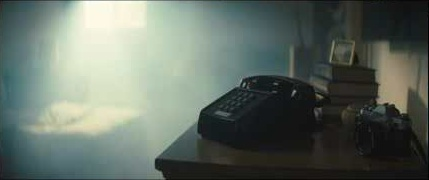

[回放相邻时间窗：00:06–00:14](https://www.youtube.com/watch?v=fFnXvKFcrIY&t=6s)

00:08

[回放相邻时间窗：00:08–00:16](https://www.youtube.com/watch?v=fFnXvKFcrIY&t=8s)

00:10

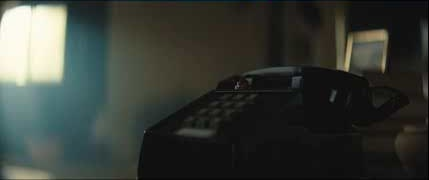

[回放相邻时间窗：00:10–00:18](https://www.youtube.com/watch?v=fFnXvKFcrIY&t=10s)

00:12

[回放相邻时间窗：00:12–00:20](https://www.youtube.com/watch?v=fFnXvKFcrIY&t=12s)

00:14

[回放相邻时间窗：00:14–00:22](https://www.youtube.com/watch?v=fFnXvKFcrIY&t=14s)

00:16

[回放相邻时间窗：00:16–00:24](https://www.youtube.com/watch?v=fFnXvKFcrIY&t=16s)

00:18

[回放相邻时间窗：00:18–00:26](https://www.youtube.com/watch?v=fFnXvKFcrIY&t=18s)

00:20

[回放相邻时间窗：00:20–00:28](https://www.youtube.com/watch?v=fFnXvKFcrIY&t=20s)

00:22

[回放相邻时间窗：00:22–00:30](https://www.youtube.com/watch?v=fFnXvKFcrIY&t=22s)

00:24

[回放相邻时间窗：00:24–00:32](https://www.youtube.com/watch?v=fFnXvKFcrIY&t=24s)

00:26

[回放相邻时间窗：00:26–00:34](https://www.youtube.com/watch?v=fFnXvKFcrIY&t=26s)

00:28

[回放相邻时间窗：00:28–00:36](https://www.youtube.com/watch?v=fFnXvKFcrIY&t=28s)

00:30

[回放相邻时间窗：00:30–00:38](https://www.youtube.com/watch?v=fFnXvKFcrIY&t=30s)

00:32

[回放相邻时间窗：00:32–00:40](https://www.youtube.com/watch?v=fFnXvKFcrIY&t=32s)

00:34

[回放相邻时间窗：00:34–00:42](https://www.youtube.com/watch?v=fFnXvKFcrIY&t=34s)

00:36

[回放相邻时间窗：00:36–00:44](https://www.youtube.com/watch?v=fFnXvKFcrIY&t=36s)

00:38

[回放相邻时间窗：00:38–00:46](https://www.youtube.com/watch?v=fFnXvKFcrIY&t=38s)

00:40

[回放相邻时间窗：00:40–00:48](https://www.youtube.com/watch?v=fFnXvKFcrIY&t=40s)

00:42

[回放相邻时间窗：00:42–00:50](https://www.youtube.com/watch?v=fFnXvKFcrIY&t=42s)

00:44

[回放相邻时间窗：00:44–00:52](https://www.youtube.com/watch?v=fFnXvKFcrIY&t=44s)

00:46

[回放相邻时间窗：00:46–00:54](https://www.youtube.com/watch?v=fFnXvKFcrIY&t=46s)

00:48

[回放相邻时间窗：00:48–00:56](https://www.youtube.com/watch?v=fFnXvKFcrIY&t=48s)

00:50

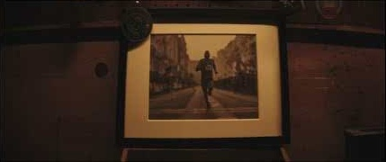

[回放相邻时间窗：00:50–00:58](https://www.youtube.com/watch?v=fFnXvKFcrIY&t=50s)

00:52

[回放相邻时间窗：00:52–01:00](https://www.youtube.com/watch?v=fFnXvKFcrIY&t=52s)

00:54

[回放相邻时间窗：00:54–01:02](https://www.youtube.com/watch?v=fFnXvKFcrIY&t=54s)

00:56

[回放相邻时间窗：00:56–01:04](https://www.youtube.com/watch?v=fFnXvKFcrIY&t=56s)

00:58

[回放相邻时间窗：00:58–01:06](https://www.youtube.com/watch?v=fFnXvKFcrIY&t=58s)

01:00

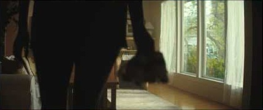

[回放相邻时间窗：01:00–01:08](https://www.youtube.com/watch?v=fFnXvKFcrIY&t=60s)

01:02

[回放相邻时间窗：01:02–01:10](https://www.youtube.com/watch?v=fFnXvKFcrIY&t=62s)

01:04

[回放相邻时间窗：01:04–01:12](https://www.youtube.com/watch?v=fFnXvKFcrIY&t=64s)

01:06

[回放相邻时间窗：01:06–01:14](https://www.youtube.com/watch?v=fFnXvKFcrIY&t=66s)

01:08

[回放相邻时间窗：01:08–01:16](https://www.youtube.com/watch?v=fFnXvKFcrIY&t=68s)

01:10

[回放相邻时间窗：01:10–01:18](https://www.youtube.com/watch?v=fFnXvKFcrIY&t=70s)

01:12

[回放相邻时间窗：01:12–01:20](https://www.youtube.com/watch?v=fFnXvKFcrIY&t=72s)

01:14

[回放相邻时间窗：01:14–01:22](https://www.youtube.com/watch?v=fFnXvKFcrIY&t=74s)

01:16

[回放相邻时间窗：01:16–01:24](https://www.youtube.com/watch?v=fFnXvKFcrIY&t=76s)

01:18

[回放相邻时间窗：01:18–01:26](https://www.youtube.com/watch?v=fFnXvKFcrIY&t=78s)

01:20

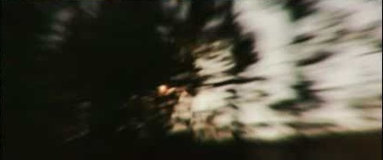

[回放相邻时间窗：01:20–01:28](https://www.youtube.com/watch?v=fFnXvKFcrIY&t=80s)

01:22

[回放相邻时间窗：01:22–01:30](https://www.youtube.com/watch?v=fFnXvKFcrIY&t=82s)

01:24

[回放相邻时间窗：01:24–01:32](https://www.youtube.com/watch?v=fFnXvKFcrIY&t=84s)

01:26

[回放相邻时间窗：01:26–01:34](https://www.youtube.com/watch?v=fFnXvKFcrIY&t=86s)

01:28

[回放相邻时间窗：01:28–01:36](https://www.youtube.com/watch?v=fFnXvKFcrIY&t=88s)

01:30

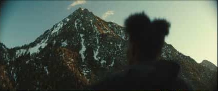

[回放相邻时间窗：01:30–01:38](https://www.youtube.com/watch?v=fFnXvKFcrIY&t=90s)

01:32

[回放相邻时间窗：01:32–01:40](https://www.youtube.com/watch?v=fFnXvKFcrIY&t=92s)

01:34

[回放相邻时间窗：01:34–01:42](https://www.youtube.com/watch?v=fFnXvKFcrIY&t=94s)

01:36

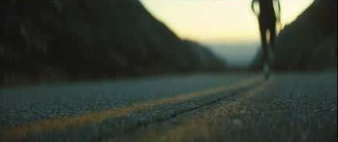

[回放相邻时间窗：01:36–01:44](https://www.youtube.com/watch?v=fFnXvKFcrIY&t=96s)

01:38

[回放相邻时间窗：01:38–01:46](https://www.youtube.com/watch?v=fFnXvKFcrIY&t=98s)

01:40

[回放相邻时间窗：01:40–01:48](https://www.youtube.com/watch?v=fFnXvKFcrIY&t=100s)

01:42

[回放相邻时间窗：01:42–01:50](https://www.youtube.com/watch?v=fFnXvKFcrIY&t=102s)

01:44

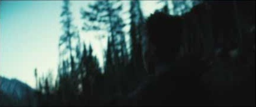

[回放相邻时间窗：01:44–01:52](https://www.youtube.com/watch?v=fFnXvKFcrIY&t=104s)

01:46

[回放相邻时间窗：01:46–01:54](https://www.youtube.com/watch?v=fFnXvKFcrIY&t=106s)

01:48

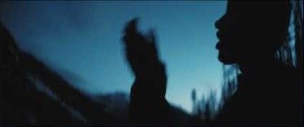

[回放相邻时间窗：01:48–01:56](https://www.youtube.com/watch?v=fFnXvKFcrIY&t=108s)

01:50

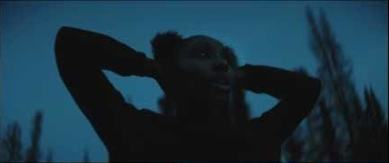

[回放相邻时间窗：01:50–01:58](https://www.youtube.com/watch?v=fFnXvKFcrIY&t=110s)

01:52

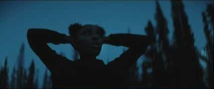

[回放相邻时间窗：01:52–02:00](https://www.youtube.com/watch?v=fFnXvKFcrIY&t=112s)

01:54

[回放相邻时间窗：01:54–02:02](https://www.youtube.com/watch?v=fFnXvKFcrIY&t=114s)

01:56

[回放相邻时间窗：01:56–02:04](https://www.youtube.com/watch?v=fFnXvKFcrIY&t=116s)

01:58

[回放相邻时间窗：01:58–02:06](https://www.youtube.com/watch?v=fFnXvKFcrIY&t=118s)

02:00

[回放相邻时间窗：02:00–02:08](https://www.youtube.com/watch?v=fFnXvKFcrIY&t=120s)

02:02

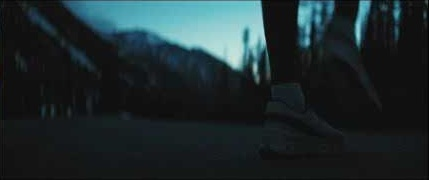

[回放相邻时间窗：02:02–02:10](https://www.youtube.com/watch?v=fFnXvKFcrIY&t=122s)

02:04

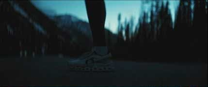

[回放相邻时间窗：02:04–02:12](https://www.youtube.com/watch?v=fFnXvKFcrIY&t=124s)

02:06

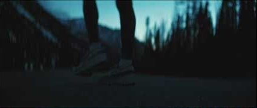

[回放相邻时间窗：02:06–02:13](https://www.youtube.com/watch?v=fFnXvKFcrIY&t=126s)

02:08

[回放相邻时间窗：02:08–02:13](https://www.youtube.com/watch?v=fFnXvKFcrIY&t=128s)

02:10

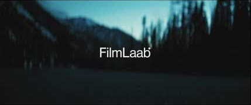

[回放相邻时间窗：02:10–02:13](https://www.youtube.com/watch?v=fFnXvKFcrIY&t=130s)

02:12

## 这份拉片的依据与边界。

### 画面依据

用户给定 YouTube 链接；播放器时长约 132.84 秒；平台预览图每 2 秒采样，共 67 张。已检查开场暂停画面与全片预览索引。这里使用的是压缩预览截图，非原始摄影文件。

### 文本依据

YouTube 英文自动转写，用于定位留言、转折和后段关系揭示。自动转写存在误识别，本文只做内容概述，不把其当作准确逐字台本。

### 未完成的测量

未直接试听音轨；无逐帧切点、音乐 BPM、响度、镜头焦距、帧率与快门参数的验证。不提供伪精确数值。复现方案为建议，已与原片观察分开。

- [用户指定原片 / FilmLaab YouTube ↗](https://www.youtube.com/watch?v=fFnXvKFcrIY)：标题标注 Spec Ad；页面说明列出导演 Mitchell Thayne、演员 Kat LaKaye、调色 Jake Pierrelee 等。
- [FilmLaab 制作方项目说明 ↗](https://www.filmlaab.com/works/on)：核实 2024、叙事选择、RED V-Raptor X、VO 与声音设计背景。该页为创作者自述；本文未将其关于比赛完成的概述直接等同于画面证据。
- [FilmLaab Vimeo 同名项目说明 ↗](https://vimeo.com/1058074170)：同样说明自主创作与父女留言概念。本报告画面时间码以用户指定的 YouTube 版本为准。

制作信息核验日期：2026-11-03。原片、演员形象与画面版权归各自权利人；本文件以分析学习为用途。AIGC 模板与原创改写不代表品牌官方意见。

**使用方法：**本 HTML 已内嵌全部分析配图，无网络也可阅读。定时原片回放需要联网，且受 YouTube 播放地区与嵌入设置影响；播放器失败时可使用“在 YouTube 打开”。若你持有本地原片，可在弹窗选择该文件，自动按时间窗回放，文件仅在当前浏览器读取。
